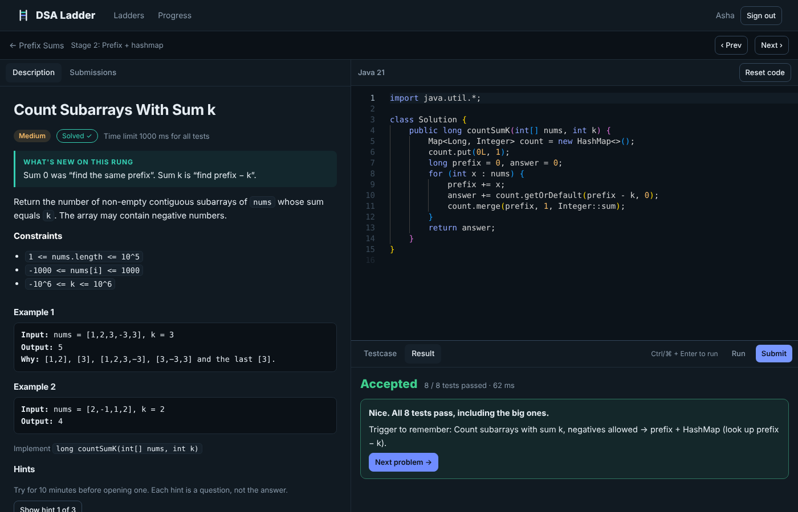

# DSA Ladder · API

Backend for **DSA Ladder**, a coding practice platform that builds problem-solving intuition the way maths books do:
lots of small problems on one idea, each a little harder than the last, then the real LeetCode problem as the final exam.

This repo contains the **Spring Boot API**, a **custom Java judge**, and the **problem books**.
The React frontend lives in **dsa-ladder-web**.



## What's here

- **Judge** (`src/main/java/dev/dsaladder/judge`, no dependencies): generates a harness for each problem's method
  signature, compiles submissions in-process with `javax.tools`, runs them in a separate JVM with time, memory and output
  limits, and returns LeetCode-style verdicts with the failing case, line numbers for runtime errors and captured `System.out`.
- **Problem books** (`problems/`): the Prefix Sums book has 23 original problems in 5 stages. Big hidden tests are generated
  deterministically from short specs and sized so O(n²) solutions get *Time Limit Exceeded*. Every reference solution is
  verified at start-up, and a brute-force solution must agree with it on ~7,400 random inputs (`JudgeCli crosscheck`).
- **API**: topics/ladders, problems, run (with custom inputs), submit, JWT auth, submission history and progress.
- **Hardening**: concurrency limit and per-user rate limits on the judge, `prlimit` sandbox prefix, non-root read-only container.

See [docs/ARCHITECTURE.md](docs/ARCHITECTURE.md) for how judging, verification and the security model work.

## Tech

Java 21 · Spring Boot 3 (Web, Security, Data JPA, Validation, Actuator) · PostgreSQL (H2 in dev) · JJWT · JUnit 5 · Docker · GitHub Actions

## Run locally

```bash
mvn spring-boot:run                 # http://localhost:8080, in-memory H2, problems from ./problems
# or with PostgreSQL in Docker:
cp .env.example .env && docker compose up --build
```

Try it: `curl localhost:8080/api/topics`

Then start the frontend from dsa-ladder-web (`npm run dev`); it proxies `/api` to `localhost:8080`.

## Tests

```bash
mvn verify                                                    # judge unit tests + API integration tests
mkdir -p build/cli && javac -d build/cli $(find src/main/java/dev/dsaladder/{judge,problems,cli} -name '*.java') \
  && cp -r src/main/resources/judge build/cli/
java -cp build/cli dev.dsaladder.cli.JudgeCli check problems       # every problem verified
java -cp build/cli dev.dsaladder.cli.JudgeCli crosscheck problems  # reference vs brute force
```

## API

| Method | Path | Auth | |
|---|---|---|---|
| GET | `/api/topics` · `/api/topics/{id}` | optional | Ladders, stages, problems, final exams |
| GET | `/api/problems/{slug}` | optional | Statement, examples, hints, starter code |
| POST | `/api/problems/{slug}/run` | optional | `{code, inputs?}` → verdict on examples or custom inputs |
| POST | `/api/problems/{slug}/submit` | optional | `{code}` → verdict on all tests; saved when signed in |
| GET | `/api/problems/{slug}/submissions` | required | Your submissions |
| POST | `/api/auth/register` · `/api/auth/login` | – | `{token, user}` |
| GET | `/api/auth/me` · `/api/me/stats` | required | Current user, progress |

## Adding problems · Deploying

[docs/AUTHORING.md](docs/AUTHORING.md) · [docs/DEPLOY.md](docs/DEPLOY.md)

## Roadmap

Problem books for the other 16 ladders · per-run network isolation with nsjail · spaced review · Python/C++ in the judge

---
Problem statements are original. Final-exam lists link to LeetCode; no LeetCode content is copied.
